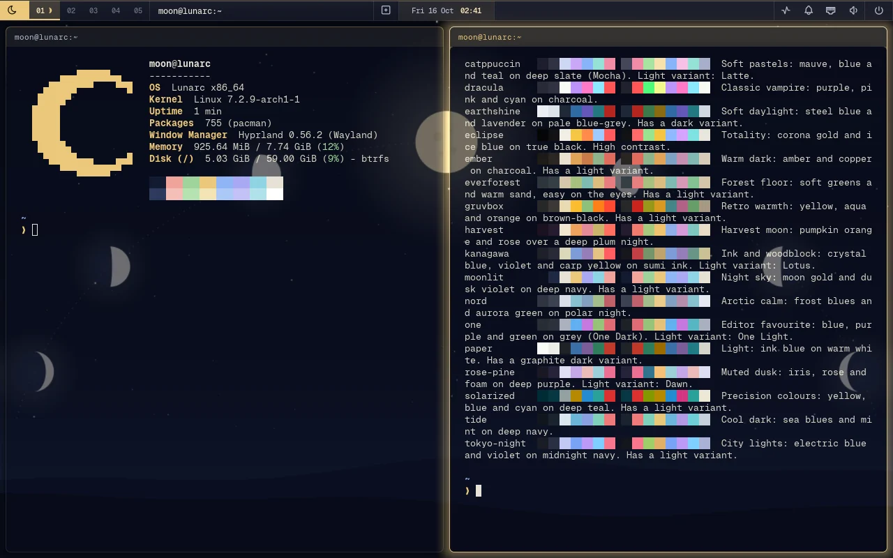

# Lunarc

An Arch Linux based desktop: Hyprland with the Noctalia shell, one command for the
system's settings, signed packages and a guided installer.

- **Arch underneath.** Arch's own packages and repositories, used as they are.
- **Private by default.** Lunarc collects and tracks nothing. Disk encryption and a
  closed firewall out of the box, and every connection a fresh install makes is
  [listed](https://lunarclinux.com/docs/privacy), with how to turn it off.
- **Updates that keep working.** Snapshots around every update, and every release is
  installed and tested in a virtual machine before it ships. Security fixes can
  install on their own.

**[Download](https://lunarclinux.com/download)** ·
**[Docs](https://lunarclinux.com/docs)** ·
**[Source](https://github.com/lunarclinux/lunarc)** ·
**[Report a problem](https://github.com/lunarclinux/lunarc/issues/new/choose)**

A preview for now: things still change between builds. Free software under the GNU
GPL, version 3 or later.
